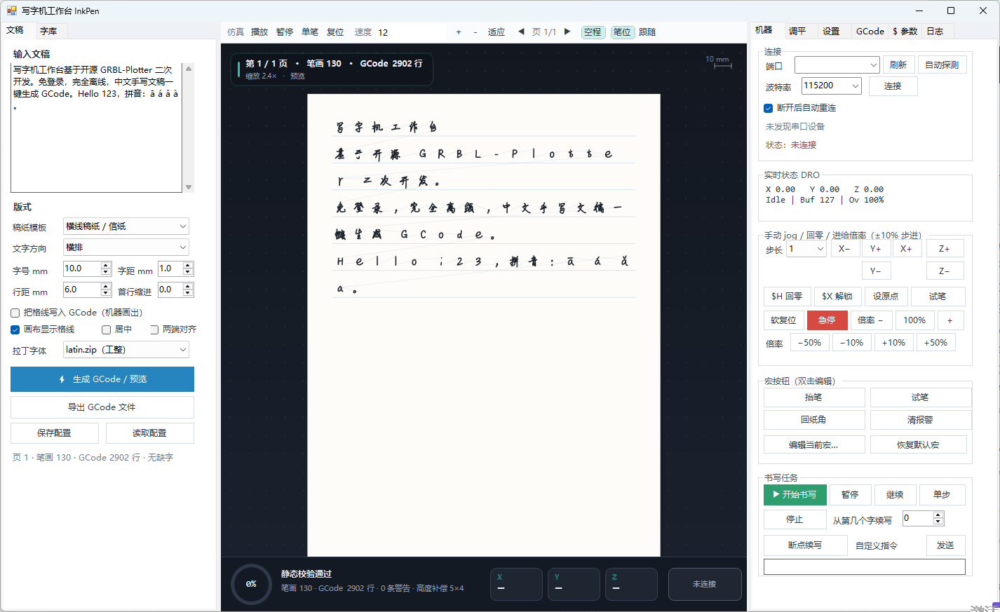
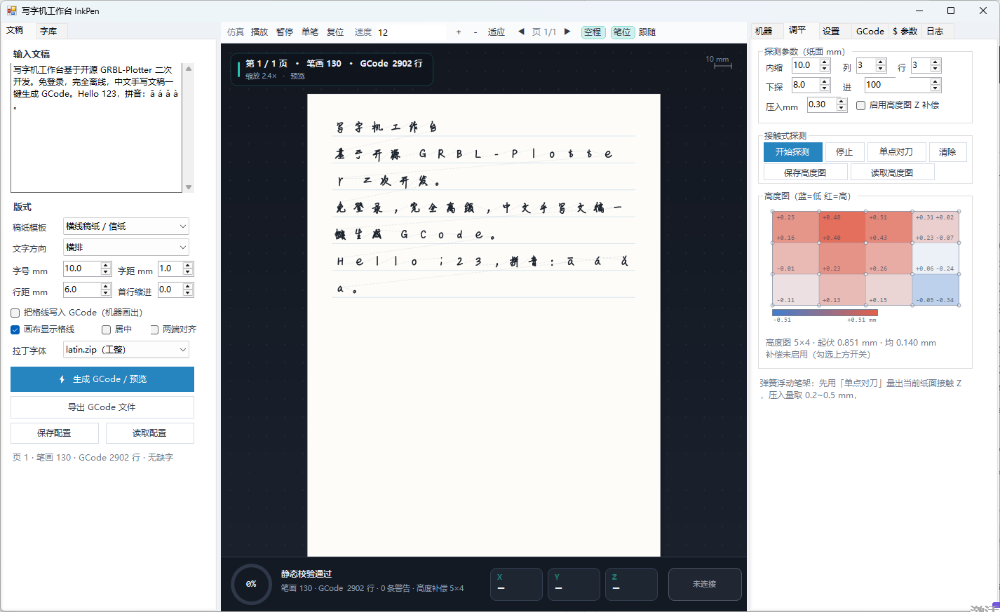

# 写字机工作台 InkPen

基于开源 **GRBL-Plotter** 二次开发的精简写字机上位机。免登录、完全离线、绿色版、中文界面。

- 输入中文文稿 → 手写单线字库排版 → Z 轴抬落笔 GCode → 可视化仿真 → 真机书写
- 21666 个码点覆盖；带正确笔顺的主库 + 本机手写风格库 + 缺字回退
- 四类稿纸模板（横线 / 方格 / 田字格 / 拼音四线三格）+ 自由排版，横/竖排、手写感滑块实时预览、断点续写、GRBL 调试全套
- **纸面高度图自动调平**（接触式 `G38.2` 探测 → 双线性插值 → 逐点 Z 补偿）、**单点对刀**、**进给倍率**、**自动重连**、**自定义宏按钮**、**画布实时笔位置**

> 当前版本 `0.1.1-M1`：离线链路、仿真与文件级校验已通过，**真机参数（Z 行程/轴方向/端口/探针接线）需你在场联调标定**。





---

## 快速开始

1. 编译：双击 `build\build.bat`（零安装：用 .NET Framework 4.8 自带 `csc.exe`，无 NuGet、无外部 DLL）。
   若会话安全策略拦截 `csc.exe`，直接双击该 bat 即可。
2. 自测：双击 `build\test.bat`（MSBuild 编译 + 160 个单元测试）→ `build\selftest.bat`（端到端）。两条链产物一致。
3. 运行：`dist\InkPen.exe`（xcopy 绿色版，不写注册表、不联网、不需登录）。
4. 左栏输入文稿 → 点「生成 GCode / 预览」→ 中栏查看仿真（多页稿可用中栏上的「‹ / ›」翻页）。
5. 中栏「▶ 播放」逐笔回放，确认字形、笔画顺序、格线、抬笔空程。
6. 「机器」页选端口 → 自动探测 → 连接 → 标定 Z → 「开始书写」。
7. （可选）「调平」页：单点对刀定书写 Z，或跑 3×3 网格探测生成高度图，勾「启用高度图补偿」后重新生成。

### 新增的机器功能（第四轮）

| 功能 | 位置 | 说明 |
|---|---|---|
| 高度图自动调平 | 「调平」页 | 网格探测 → 失败点 4 邻域补值 → 3×3 均值平滑 → 双线性插值 → 逐点 Z 补偿（变化 < 0.005 mm 不输出）。未启用时 GCode **一字不变** |
| 单点对刀 | 「调平」页 | 就地 `G38.2` 探到纸面，`接触Z + 压入量`（默认 0.3 mm，弹簧笔架建议 0.2–0.5）直接回写书写 Z |
| 进给倍率 | 「机器」页 | −50/−10/+10/+50 %，内部按 10% 整数倍连发 `0x91/0x92`（GRBL 无任意百分比接口） |
| 自动重连 | 「机器」页 | 指数退避 1→2→4→8→16→30 s 封顶，默认 8 次；主动断开不触发；重连后提示「需重新设原点」 |
| 自定义宏 | 「机器」页 | 4 个按钮，双击/右键编辑，占位符 `{safez}{writez}{xyfeed}{zfeed}`，存 `config/macros.json` |
| 画布实时笔位置 | 中栏工具栏 | 「笔位」显示笔尖当前 XY（含 Z），「跟随」自动居中；WPos 优先于 MPos，33 ms 平滑插值 + 光晕 + 十字准星 |

### 首次真机标定清单（务必按顺序）

| 步骤 | 操作 | 判据 |
|---|---|---|
| 1 | 「设置」页填幅面、原点角、X/Y 反向 | 与纸张实际摆放一致 |
| 2 | 「试笔」按钮 | 笔尖接触纸面且抬起干净；方向相反则调 `安全 Z` 符号 |
| 3 | jog Z± 观察 | 确认 `$102` 方向；`安全 Z > 书写 Z` |
| 4 | 小字号写一两个字 | 无拖墨、无划纸、笔画完整 |
| 5 | 「从第 N 个字续写」 | 中断后不重不漏 |
| 6 | 「调平」页「单点对刀」 | 探针接触即停、`[PRB:]` 有回报、书写 Z 自动回填 |
| 7 | 3×3 网格探测 → 勾「启用高度图补偿」→ 重新生成 | 热力图有颜色分布；GCode 里 `G1 X.. Y.. Z..` 行尾出现变化的 Z |
| 8 | 保存配置 | 下次直接复用 |

> 弹簧浮动笔架不必追求「高度图把 Z 抹平」，它补偿的是**纸面整体倾斜**（倾斜会让压入量沿 X/Y 线性变化，一端拖墨一端断墨）。压入量 `PressDepthMm` 建议 0.2–0.5 mm，先小后大，宁可浅一点。

> 本机奎享雕刻默认是 **舵机** 抬笔（`pen_up_pos/pen_down_pos`），与你的 **Z 轴步进** 硬件不同，其参数不可照抄。

---

## 目录

```
src/App/              主程序源码（C# 5 / WinForms / 零外部 DLL）
src/Upstream/         GRBL-Plotter 源码快照（只读参考，保留原版权头）
tests/InkPen.Tests/   MSTest v2 单元测试（160 个，引用主程序工程，复用生产代码）
data/glyphs/          字库 ZIP（InkPen Glyph v1）+ schema.json
data/glyphs/dev/      开发态每字 JSON（可 diff / 手绘补录）
tools/                Python 3.12 离线字库与校验脚本（不随 exe 分发）
tools/selftest/       无 GUI 端到端自检（C#，复用生产 Core）
tools/gui_check/      界面自动化验收（Win32 消息驱动，无人值守）
build/                sources.rsp + build.bat / test.bat / selftest.bat + version.txt
dist/                 绿色版输出
dist/selftest/        自检生成的 .nc 样例（可离线复验）
InkPen.sln            VS 解决方案（主程序 + 测试工程）
LICENSES/             第三方许可证原文
NOTICE.md             SBOM、衍生关系、Arphic 三层口径、格式命名契约
docs/                 字库报告、M1 验收记录、界面截图、测试盲区复盘、与上游功能差异清单
```

## 编译链

| 链 | 用途 |
|---|---|
| `csc.exe` 直编 + `build.bat` | **日常主链**，零依赖、零 NuGet；命令文本不含被会话拦截的关键字，产物与 MSBuild 链一致 |
| MSBuild + `test.bat` | **测试主链**：`InkPen.sln` → `src/App/InkPen.csproj` + `tests/InkPen.Tests/InkPen.Tests.csproj`，跑 160 个 MSTest 用例。工具链为 VS 2022 Build Tools 17.14（`C:\Program Files (x86)\Microsoft Visual Studio\2022\BuildTools`，含 .NET Framework 4.8 Targeting Pack、NuGet、vstest.console） |
| Python 3.12.10 | 仅离线字库生成/转换/校验；所有脚本用绝对路径 `...\Python312\python.exe`，避免与 Git Bash 的 3.13 混淆 |

> 两条 C# 链共享 `build/pack.bat` 打包步骤，`dist/` 内容一致；改代码后建议 `test.bat`（含单元测试）再 `build.bat`。
> 安装 Build Tools 时若 `winget` 报 `exit code 5002 / 已添加项。字典中的关键字:"HTTPS_PROXY"`，先清掉大小写重复的代理变量再重跑：
> `env -u HTTP_PROXY -u HTTPS_PROXY -u http_proxy -u https_proxy winget install Microsoft.VisualStudio.2022.BuildTools`

重建字库：

```bat
C:\Users\Administrator\AppData\Local\Programs\Python\Python312\python.exe tools\build_glyph_db.py
C:\Users\Administrator\AppData\Local\Programs\Python\Python312\python.exe tools\import_gfont.py
C:\Users\Administrator\AppData\Local\Programs\Python\Python312\python.exe tools\validate_glyphs.py
C:\Users\Administrator\AppData\Local\Programs\Python\Python312\python.exe tools\pack_font.py export
```

## 离线验收（不接机器）

接真机前先跑这两条，全部通过才进入标定。自检直接复用生产 `Core` 源码，不是另写一套逻辑：

在 `cmd.exe` 中（也可直接双击 `build\selftest.bat`）：

```bat
cd /d D:\Writer\InkPen\build
set INKPEN_CI=1
cmd /c build.bat
cmd /c selftest.bat
```

```bat
cd /d D:\Writer\InkPen
C:\Users\Administrator\AppData\Local\Programs\Python\Python312\python.exe tools\validate_gcode.py dist\selftest\a_mixed.nc 210 297
C:\Users\Administrator\AppData\Local\Programs\Python\Python312\python.exe tools\validate_gcode.py --selftest
```

`selftest.bat` 编译 `tools\selftest\SelfTest.cs` 为控制台程序，覆盖：汉字 / 数字 / 拉丁 / 带调拼音 / 标点混排、五类模板、横竖排、4 页 26828 行大稿、格线写入 GCode、确定性复现（同种子字节一致）、断点续写前缀。产物落在 `dist\selftest\*.nc`，再用 `validate_gcode.py` 逐份做文件级静态校验（Z 抬落笔、F>0、XY 越界、续写元数据、单行字节上限）。

**校验口径**：GRBL 忽略空格，发送前会压缩，因此按「去空格后字节数」计算；GRBL 1.1 单行缓冲默认 80 字节，超限会被静默截断写出错字，故 C# 校验器、Python 校验器、流控发送器三处统一按 80 字节硬拦截。

### 单元测试与界面自检

```bat
cd /d D:\Writer\InkPen\build
INKPEN_CI=1 cmd /c test.bat
```

`test.bat` = NuGet 还原 → 编译 `InkPen.sln` → 打包 → 跑 `vstest.console`。当前 **160 个用例全通过**，覆盖：

| 测试文件 | 用例 | 覆盖点 |
|---|---|---|
| `GeometryTests` | 11 | 四原点角坐标变换、X/Y 反向、RDP 抽稀（保端点/保尖角/零容差）、手写扰动哈希确定性、笔锋延长、随机数可复现 |
| `JsonTests` | 8 | 基本类型、转义、嵌套、往返、脏输入不抛异常、**UTF-8 BOM 容忍** |
| `LayoutTests` | 11 | 横/竖排、缺字上报、分页且字形带正确页号、五类格线、同种子确定性、首行缩进、居中、空文本、字号缩放 |
| `GCodeTests` | 11 | 抬头/结尾、`G1 Z0`/`G0 Z5`/`G4`、续写元数据注释、原点角翻转、格线开关、字节级确定性、续写前缀、越界返回末尾 |
| `ValidatorTests` | 10 | 空程序、缺 Z、>80 字节、XY 越界、容差内负坐标、SafeZ 告警、非正进给、幂等清空 |
| `GlyphRepositoryTests` | 9 | 码点命名、二进制解码、缓存同实例、启用/禁用、重复 Load 不叠加、**真实字库 2 万+ 码点存在性** |
| `GlyphOrientationTests` | 6 | **字库方向契约（X 与 Y 双向）**：`local`/`mmah` 垂直与水平重心相关系数须为正（整包镜像会变负）、「三」上横短于下横、「P」圆环在上、「L」顶部竖笔贴左缘、「F」左半点数占优 |
| `GrblProtocolTests` | 8 | 九种状态解析、WPos、`WCO:` 换算、垃圾输入、`$` 参数、端口枚举、未连接安全拒绝 |
| `StreamControllerTests` | 4 | 超单行缓冲中止、ack 超时中止不挂死、跳过注释空行、`Stop()` 终止线程 |
| `LifecycleTests` | 9 | 停后重启只认新作业、15 次抖动不错乱、暂停仍算运行中、空作业、越界起始行夹取、画布页数/翻页夹取、路径页号不串页 |
| `UiContractTests` | 5 | 模板下拉与枚举映射（错位缺陷回归）、`$` 参数中文说明覆盖标定关键项、已排版字数统计 |
| `ConfigBinderTests` | 6 | 全字段类型往返、缺键保默认、脏数据不抛、`int`→`double`、null 输入 no-op |
| `MachineFeatureTests` | 43 | **高度图**（读写/双线性插值/区域外夹取/平滑只削内部毛刺/归一化/JSON 往返含 Valid）、**坐标逆变换**（`ToPaper` 必须先撤 Invert 再撤原点角）、**Z 补偿**（未启用时 GCode 一字不变、倾斜纸面才输出额外 Z）、**探测规划**（纸面点转机器坐标发包、失败点 4 邻域补值）、**探测器状态机**（`[PRB:]` 解析、推进前必抬笔、取消即停、迟到回报不记到下一个点）、**笔跟踪**（WPos 优先、只有 MPos+WCO 时自算、两者都无则视为无效）、**重连退避**（指数增长、30 s 封顶）、**宏**（占位符展开、JSON 往返） |
| `AuditRegressionTests` | 19 | **多维度审计的缺陷回归**：抬笔跟着纸面倾斜抬高、续写前缀先声明单位再动 Z、续写进连笔段补回落笔、悬挂标点有上限、行首空格不越界、行尾禁则跨页不错位、两端对齐不因缩进而溢出、页底不多扣一个字高、格线随缩进吸附、代理对按码点计数、小网格平滑不抹平倾斜、迟到 `[PRB:]` 不被错记账、`LoadErrors` 不跨次累积 |

> 这些用例做过**注入验证**：故意把实现改坏，确认测试会红。首轮 7 处注入只抓到 6 处——转置缺陷因 2×2 网格对称而漏检、漏抬笔因断言只比字符串相同而漏检。两处都已加固（3×2 非对称网格、比对总行数与具体下标），复验均能抓到。复盘见 `docs/testing_pitfalls.md`。

界面层另外做了四项自动化实测（Win32 `EnumWindows`/`BM_CLICK` + 截图像素统计，非人工目测）：

| 检查 | 判据 | 结果 |
|---|---|---|
| 冒烟 | 主窗 `写字机工作台 InkPen` 可见外框 1426×873（窗口设定 1440×880）、111 个子窗口、无错误对话框、纸张内部墨迹比 0.0154、纸张左右留白 104/122 px（`paper_w=501 canvas_w=727`，居中未被裁切） | PASS |
| 交互 | 勾选「把格线写入 GCode」再生成：笔画 130→137、GCode 2902→2920 行 | PASS |
| 配置 | 保存配置 → JSON **无 BOM**、含 `template/machine/text` → 读取成功 | PASS |
| 调平页 | 隐藏参数 `--tab=level` 直开标签页：探测/高度图控件齐全、热力图有像素、无错误框 | PASS |

> 墨迹比只在**纸张矩形内部**统计。改深色画布后，若仍按「中栏深色像素」判定，会永远通过——这类判据失效比测试失败更危险，已修正。

一条命令跑完四项（脚本在 `tools/gui_check/`，只用 Win32 消息，不碰鼠标）：

```bat
cd /d D:\Writer\InkPen
cmd /c tools\gui_check\gui_check.bat all
```

截图存档：`docs/gui_smoke.png`（主界面）、`docs/gui_level.png`（调平页）。

### 构建模式

| 命令 | 结果 |
|---|---|
| `build.bat` | **默认，本机自用**：含 `local.zip`（本机奎享 `.gfont` 导入的专有手写库），提供本机手写风格 |
| `INKPEN_DISTRIBUTE=1 build.bat` | **可分发**：自动排除 `local.zip` 与 `local_report.json`，只留开放许可字库 |

> `local.zip` 为专有数据、仅限本机使用。默认构建会在日志打印 `FOR THIS MACHINE ONLY - do not redistribute`；对外分发前务必用 `INKPEN_DISTRIBUTE=1` 重建。

### 从 Git 克隆后注意

仓库**不包含** `data/glyphs/local.zip`（专有字库，见 `.gitignore` 与 `NOTICE.md` §4）。克隆后：

- 程序照常启动，回退链自动跳过 `local`，用 `mmah` / `pinyin` / `latin` / `fallback` 出稿；
- `GlyphOrientationTests` 会自动**跳过**与 `local.zip` 相关的两项方向比对（显示为 skipped，不是失败），其余 138 项照跑；
- 想在克隆的机器上用自己的手写风格，把该机器的 `.gfont` 放好后跑 `python tools/import_gfont.py` 自行生成；
- 缺少的上游字库原料（`tools/_src/`、两份 `.tar.gz`）同样不入库，`python tools/build_glyph_db.py` 会提示下载地址。

### 流控中止行为（不重发）

书写中遇到 `error:` / `ALARM:` / `<Alarm>` 状态、等待 `ok` 超时、或 GCode 行超长时，**立即停止发送且不自动重发**——字符计数流控下在途可能有多行，盲目重发会写出重复笔画。日志给出「最早未确认行号」，配合「从第 N 个字续写」恢复。超时阈值在「设置 → Z 轴」页的 `ack 超时 s` 调整（默认 30 s，0 为禁用；长 `G4` 延时或慢速长行程需调大）。

## 字库与坐标

- 格式：**InkPen Glyph v1**（ZIP + 码点命名 + 紧凑二进制；显式笔画边界；1024 网格、Y-up）
- 回退链：`local`(本机手写) → `mmah`(笔顺主库) → `pinyin` → `latin` → `latin_script` → `fallback`
- 「本机手写优先」关闭时 `local` 只是降到链尾做**缺字兜底**，仍会被加载；自检实测 38 个探针字符在该模式下 0 个来自 `local`，故常规文稿输出可复现。需要严格跨机器一致时用 `INKPEN_DISTRIBUTE=1` 构建（不含 `local.zip`）。
- 字库层固定 Y-up 0..1024；方向差异只在末端各翻一次（画布翻屏幕 Y-down，机床由原点角/轴反向决定）
- **三种同名/近名字库格式不直接等同**：奎享 `.gfont`（私有二进制）、WriterStudio `.gfont`（同名、产品定位相近，存在同源线索）、本项目 `.zip`（InkPen Glyph v1 自有格式）。两种 `.gfont` 的结构兼容/同构关系**未实测**，本项目不假定兼容、不消费 WriterStudio `.gfont`；`.gfont` 转换走自写 `tools/import_gfont.py`（跳过 43 KB 私有前缀），只解析本机奎享文件做导入转换，不产出 `.gfont`

## 许可

主程序 GPL-3.0-or-later（GRBL-Plotter 衍生）；字库数据分别适用 Arphic Public License / MIT / 经典 Hershey **自有宽松许可**（自由使用 + 致谢 / free use + acknowledgement，禁转 US NTIS 格式；**非 OFL、非 GPL**）/ 自有；本机奎享字库专有且**不随软件分发**。SIL OFL 1.1 仅覆盖未随本发行版提供的 29 个 EMS 现代衍生字体，`LICENSES/OFL-1.1.txt` 仅作出处链记录。经典 Hershey 的 USE RESTRICTION 逐字全文见 `LICENSES/ACKNOWLEDGEMENT.txt`（覆盖随附 `latin*.zip` 衍生数据与只读上游源码快照中的内嵌字形数组）。详见 `NOTICE.md` 与 `LICENSES/`。

用户当前选择「仅自用、不分发」——GPL / Arphic 的对外源码与开放义务在分发时才触发，现已提前准备。
